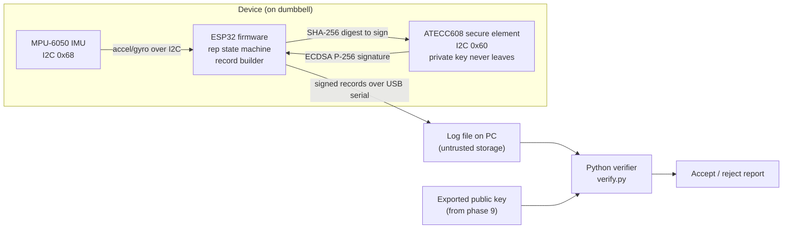

# Anti-Spoof Rep Validator

> **Status: work in progress.** This is a learning project being built step by step. Nothing below is claimed to work yet; every unfinished item is marked **TODO** and tracked in the [Roadmap](#roadmap).

## Pitch

The Anti-Spoof Rep Validator is a dumbbell bicep-curl rep counter that tries to make its rep count *trustworthy*, not just accurate. An ESP32 reads an MPU-6050 IMU strapped to the dumbbell and detects reps from the pitch-angle swing (about 0° up to about 120° and back). Each rep is turned into a small record that a SparkFun ATECC608 secure element signs with an ECDSA P-256 key that is generated inside the chip and can never be read out. Every record carries a monotonic counter, the device serial number, and the hash of the previous record, so a Python verifier on a PC can detect forged, edited, replayed, or deleted records. The final phase is to attack my own device and write up what held up and what did not.

## Why it matters for security

Fitness data is low-stakes, but the pattern is the same one used in high-stakes embedded systems: a cheap sensor produces data, and someone downstream has to decide whether to trust it. This project practices:

- **Hardware root of trust** – keeping a private key inside a secure element instead of in flash.
- **Data integrity and provenance** – signatures, monotonic counters, and hash chains.
- **Threat modeling** – writing down assets, trust boundaries, and attacker capabilities *before* claiming anything is secure.
- **Offensive testing of my own design** – bus sniffing, sensor spoofing, firmware reflash, and log tampering, with evidence.
- **Honest limits** – a signature proves *which device* produced a record, not that a human actually lifted a dumbbell. See [THREAT_MODEL.md](THREAT_MODEL.md).

## Architecture



Planned record contents (TODO: finalize in phase 11): monotonic counter, device serial number, rep data (e.g. timestamp, peak angle), hash of the previous record, and an ECDSA signature over all of the above.

## Hardware / BOM

| Qty | Part | Notes |
|----:|------|-------|
| 1 | ESP32 dev board (e.g. ESP32-DevKitC / ESP32-WROOM-32) | Programmed with Arduino IDE + Arduino-ESP32 core |
| 1 | MPU-6050 IMU breakout (GY-521 or similar) | I2C address 0x68 (AD0 low) |
| 1 | SparkFun Cryptographic Co-Processor Breakout – ATECC608 (Qwiic) | I2C address 0x60 |
| 1 | **Spare ATECC608 breakout (recommended)** | Locking the config zone is permanent; a spare lets you recover from a bad config |
| 1 | Qwiic-to-male-header cable (or Qwiic adapter) | To connect the Qwiic board to ESP32 header pins |
| 1 | Breadboard + jumper wires | |
| 1 | USB cable for the ESP32 | Power + serial |
| 1 | Dumbbell + strap/mount for the IMU | Velcro, zip ties, or a 3D-printed clip |
| 1 | Logic analyzer (e.g. 8-channel USB, sigrok/PulseView compatible) | For phases 3 and 12 |
| 1 | Second ESP32 (for attack phase) | Used to impersonate the IMU on the I2C bus |

## Wiring

Both I2C devices share **one** bus. Everything runs at **3.3 V**. Full details: [docs/wiring.md](docs/wiring.md).

| Signal | ESP32 pin | MPU-6050 | ATECC608 (Qwiic) |
|--------|-----------|----------|------------------|
| 3.3 V  | 3V3       | VCC      | 3.3V (Qwiic red) |
| GND    | GND       | GND      | GND (Qwiic black) |
| SDA    | GPIO21    | SDA      | SDA (Qwiic blue) |
| SCL    | GPIO22    | SCL      | SCL (Qwiic yellow) |

## Roadmap

Each phase has a matching entry in the [lab notebook](docs/lab-notebook.md) once started.

- [ ] **1. Bring-up** – blink an LED and print to serial ([firmware/01_blink](firmware/01_blink/01_blink.ino))
- [ ] **2. I2C basics + bus scan** – find 0x68 and 0x60 ([firmware/02_i2c_scanner](firmware/02_i2c_scanner/02_i2c_scanner.ino))
- [ ] **3. Bus sniffing with a logic analyzer** – capture and decode I2C traffic ([captures/](captures/))
- [ ] **4. IMU reading + calibration** – stream accel/gyro, remove offsets ([firmware/04_imu_stream](firmware/04_imu_stream/04_imu_stream.ino))
- [ ] **5. Rep detection state machine** – count curls from pitch angle ([firmware/05_rep_counter](firmware/05_rep_counter/05_rep_counter.ino))
- [ ] **6. ATECC608 read-only intro** – read serial number and config zone ([firmware/06_atecc_info](firmware/06_atecc_info/06_atecc_info.ino))
- [ ] **7. Config/slot design on paper** – plan slots before touching locks ([docs/atecc608-config-notes.md](docs/atecc608-config-notes.md))
- [ ] **8. Config + data zone LOCK** – ⚠️ **permanent and irreversible**
- [ ] **9. Key generation, first signature, public key export** ([firmware/09_first_signature](firmware/09_first_signature/09_first_signature.ino))
- [ ] **10. Python verifier** – verify a signature on the PC ([verifier/](verifier/README.md))
- [ ] **11. Signed reps with counter + hash chain** ([firmware/11_signed_reps](firmware/11_signed_reps/11_signed_reps.ino))
- [ ] **12. Attack my own device + threat model** ([THREAT_MODEL.md](THREAT_MODEL.md))

## Repo layout

```
anti-spoof-rep-validator/
├── README.md                 you are here
├── THREAT_MODEL.md           assets, trust boundaries, attacks, results
├── LICENSE                   MIT
├── docs/
│   ├── wiring.md             pin table + diagram
│   ├── atecc608-config-notes.md  slot plan (locking warning!)
│   └── lab-notebook.md       dated build log
├── firmware/                 one Arduino sketch folder per phase
│   ├── 01_blink/
│   ├── 02_i2c_scanner/
│   ├── 04_imu_stream/
│   ├── 05_rep_counter/
│   ├── 06_atecc_info/
│   ├── 09_first_signature/
│   └── 11_signed_reps/
├── verifier/                 Python signature + chain verifier
│   ├── README.md
│   ├── requirements.txt
│   ├── verify.py
│   └── tests/
├── data/samples/             sample record logs (TODO)
└── captures/                 logic analyzer captures (TODO)
```

## Build instructions

### Firmware (TODO: confirm versions once tested)

1. Install the [Arduino IDE](https://www.arduino.cc/en/software).
2. Add the Arduino-ESP32 core via Boards Manager (search "esp32" by Espressif Systems). TODO: record the exact core version used.
3. Install libraries via Library Manager:
   - SparkFun ATECCX08a Arduino Library
   - Adafruit MPU6050
   - Adafruit Unified Sensor
4. Open a sketch folder in `firmware/`, select your ESP32 board and port, and upload.
5. Open Serial Monitor at **115200 baud**.

### Verifier (TODO)

```bash
cd verifier
python -m venv .venv
source .venv/bin/activate      # Windows: .venv\Scripts\activate
pip install -r requirements.txt
python verify.py --help
```

## Security model

Summary (details and test results in [THREAT_MODEL.md](THREAT_MODEL.md)):

- **What is protected:** the integrity and order of rep records after they leave the device. A record that is edited, forged, replayed, reordered, or deleted should be rejected by the verifier.
- **How:** an ECDSA P-256 private key generated inside the ATECC608 (never readable), a monotonic counter, a device serial in every record, and a hash chain linking each record to the previous one.
- **What is *not* protected:** whether the motion was a real human curl. Anyone holding the device can shake it or move it with a machine. Raw IMU data on the I2C bus is also not authenticated, so a spoofed IMU can feed fake motion that the device will sign honestly.
- **Status:** TODO – nothing has been tested yet.

## Demo

TODO: add photos, a short video/GIF of reps being counted, and example verifier output (accepted log vs. tampered log) once phases 5, 10, and 11 are done.

## Future work (out of scope for now)

- Companion phone app / BLE transport
- Velocity-based training metrics (bar speed, power)
- Battery power and enclosure
- Authenticating the IMU-to-MCU link (sensor-side signing)
- Secure boot + flash encryption on the ESP32

## Author

Thor DeMarco – Computer Engineering undergraduate, UMBC. Interested in cybersecurity and defense internships.

## License

MIT – see [LICENSE](LICENSE). Third-party libraries keep their own licenses.
