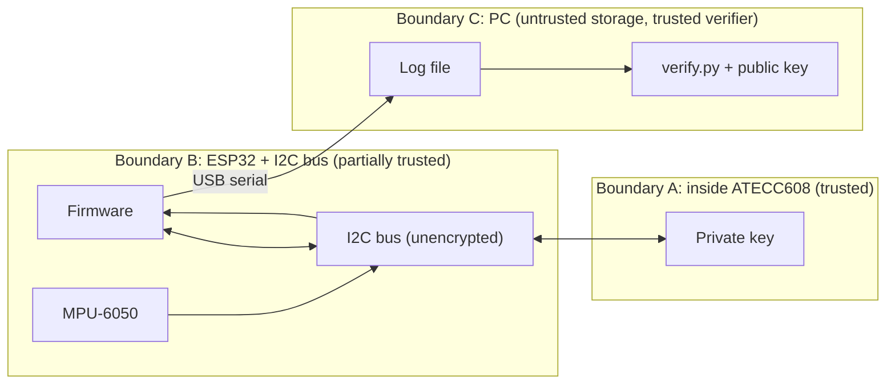

# Threat Model – Anti-Spoof Rep Validator

> **Status: template.** No attacks have been run yet. Every result below is **Not yet tested**. Fill in the Evidence column only with things you actually captured (logs, screenshots, captures in [captures/](captures/), notebook entries in [docs/lab-notebook.md](docs/lab-notebook.md)).

Back to [README](README.md).

## 1. System summary

An ESP32 reads an MPU-6050 IMU over I2C, detects bicep-curl reps, builds a record per rep, and asks an ATECC608 secure element (same I2C bus) to sign it with an ECDSA P-256 key generated inside the chip. Records go over USB serial to a PC, are saved to a log file, and are checked by `verifier/verify.py` using the exported public key.

## 2. Security goals

- **G1 – Authenticity:** a valid record can only have been produced by *this* ATECC608.
- **G2 – Integrity:** any change to a record's fields is detected.
- **G3 – Freshness / ordering:** replayed, duplicated, or reordered records are detected (monotonic counter).
- **G4 – Completeness:** deleting a record from the middle of a log is detected (hash chain).
- **G5 – Key secrecy:** the private key never appears on the I2C bus, in ESP32 flash, or in any file.

Non-goal: proving that a real human performed a real curl (see [Out of scope](#7-out-of-scope)).

## 3. Assets

| Asset | Where it lives | Why it matters |
|-------|----------------|----------------|
| ECDSA P-256 private key | Inside ATECC608 slot (TODO: slot number from config notes) | If leaked, anyone can forge records |
| Public key | Exported to PC (TODO: file name/format) | Verifier trusts whatever key it is given |
| Device serial number | ATECC608 (factory) | Binds records to one device |
| Monotonic counter value | TODO: ATECC608 counter vs. ESP32 storage | Detects replay/rollback |
| Rep records / log file | PC disk | The data being protected |
| Firmware | ESP32 flash | Decides what gets signed |

## 4. Trust boundaries

- **A:** Only the ATECC608 internals are fully trusted.
- **B:** The I2C bus is plain-text and physically reachable. The ESP32 firmware can be reflashed by anyone with USB access (no secure boot in scope).
- **C:** The log file is assumed to be attacker-controlled. The verifier and its copy of the public key are assumed trustworthy.

## 5. Attacker capabilities (assumed)

- Has physical access to the device and the dumbbell.
- Can connect a logic analyzer or a second microcontroller to the I2C bus.
- Can reflash the ESP32 over USB.
- Can read, edit, copy, reorder, and delete the log file.
- **Cannot** decap the chip, do power/EM side-channel analysis, or fault-inject the ATECC608 (out of scope for a student lab).

## 6. Attack table

| # | Attack | Mitigation (planned) | Status | Evidence |
|---|--------|----------------------|--------|----------|
| 1 | **Shake / fake motion** – shake the device or swing it by hand without a real curl to inflate the count | Rep state machine thresholds (angle range, minimum/maximum rep duration). Signature does *not* help here. | Not yet tested | TODO |
| 2 | **Spoofed IMU on I2C bus** – second ESP32 acts as an I2C target at 0x68 and feeds fake accel/gyro data | None in core design (IMU data is unauthenticated). Possibly plausibility checks (TODO). Expected to partially succeed; document honestly. | Not yet tested | TODO |
| 3 | **Firmware reflash** – flash malicious firmware that asks the ATECC608 to sign fabricated reps | ATECC608 still signs whatever it is given; counter + serial still bind records. Secure boot is future work. Expected to succeed; document honestly. | Not yet tested | TODO |
| 4 | **Log replay** – resubmit an old valid log or duplicate valid records | Monotonic counter; verifier rejects non-increasing counters | Not yet tested | TODO |
| 5 | **Log edit** – change a field (e.g. rep count, timestamp) in a stored record | ECDSA signature over all record fields | Not yet tested | TODO |
| 6 | **Record deletion / reordering** – remove or swap records in a log | Hash chain (each record contains hash of previous) + counter gaps | Not yet tested | TODO |
| 7 | **Forged record with wrong key** – sign records with an attacker-generated key | Verifier pins the exported device public key and serial | Not yet tested | TODO |
| 8 | **I2C sniffing for key material** – capture all bus traffic with a logic analyzer during key generation and signing | Private key generated and used inside ATECC608; only public key and signatures should appear on the bus | Not yet tested | TODO (capture file in [captures/](captures/)) |

Status values to use: `Not yet tested`, `Mitigated (evidence)`, `Partially mitigated`, `Not mitigated (accepted risk)`.

## 7. Out of scope

- **Physical analog motion spoofing:** a machine, another person, or a hand moving the dumbbell through a realistic curl. The device cannot know who or what is moving it.
- Invasive hardware attacks on the ATECC608 (decapping, microprobing, fault injection, side-channel analysis).
- Secure boot / flash encryption on the ESP32 (future work).
- Compromise of the PC running the verifier or substitution of the trusted public key.
- Companion app, BLE transport, velocity metrics, battery (future work).

## 8. Results summary

TODO: after phase 12, summarize which goals held, which did not, and what you would change.
