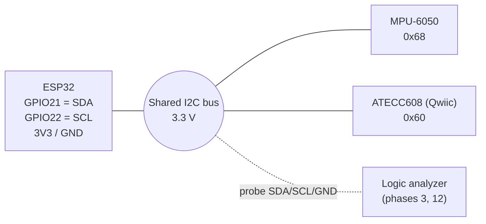

# Wiring

Back to [README](../README.md).

> TODO: confirm against your actual boards and add a photo of the breadboard once built.

## Key points

- **One shared I2C bus.** The MPU-6050 (address `0x68`) and the ATECC608 (address `0x60`) are on the *same* SDA/SCL lines. Different addresses mean they do not conflict.
- **3.3 V only.** The ESP32 uses 3.3 V logic. Power both modules from the ESP32 **3V3** pin, not 5 V / VIN.
- **Qwiic is 3.3 V.** The SparkFun Qwiic connector standard is 3.3 V. Do not feed 5 V into it.
- **Pins:** SDA = GPIO21, SCL = GPIO22 (`Wire.begin(21, 22);` in firmware).
- **Pull-ups:** I2C needs pull-up resistors on SDA and SCL. Many breakout boards (including GY-521 and SparkFun Qwiic boards) already include them. TODO: check which of your boards have pull-ups and whether combined pull-up strength is reasonable.
- **MPU-6050 AD0:** leave AD0 low/unconnected for address `0x68`. If AD0 is pulled high the address becomes `0x69`.

## Pin table

| Signal | ESP32 | MPU-6050 (GY-521) | ATECC608 Qwiic breakout | Qwiic wire color |
|--------|-------|-------------------|-------------------------|------------------|
| Power  | 3V3   | VCC               | 3.3V                    | Red    |
| Ground | GND   | GND               | GND                     | Black  |
| SDA    | GPIO21| SDA               | SDA                     | Blue   |
| SCL    | GPIO22| SCL               | SCL                     | Yellow |
| —      | —     | AD0 → GND/NC (0x68) | —                     | —      |
| —      | —     | INT (unused for now) | —                     | —      |

## Diagram

```
ESP32 3V3    ──┬────────────────────┬──────────────  3.3 V
ESP32 GND    ──┼──┬─────────────────┼──┬───────────  GND
ESP32 GPIO21 ──┼──┼──┬──────────────┼──┼──┬────────  SDA
ESP32 GPIO22 ──┼──┼──┼──┬───────────┼──┼──┼──┬─────  SCL
               │  │  │  │           │  │  │  │
              VCC GND SDA SCL      3V3 GND SDA SCL
             ┌──────────────┐    ┌─────────────────┐
             │   MPU-6050   │    │ ATECC608 Qwiic  │
             │  addr 0x68   │    │   addr 0x60     │
             └──────────────┘    └─────────────────┘
```



## Logic analyzer hookup (phase 3)

TODO: channel 0 → SCL, channel 1 → SDA, analyzer GND → ESP32 GND. Record the sample rate used and save captures in [captures/](../captures/).
